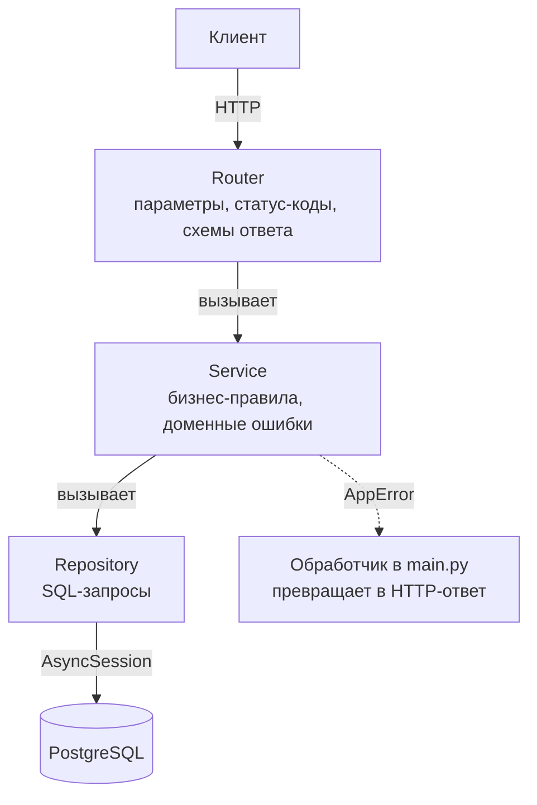
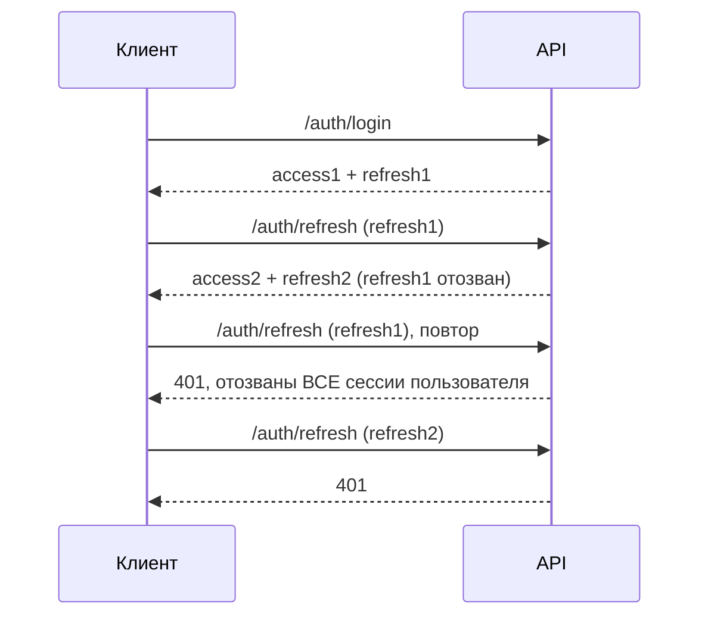

# TaskFlow API

[](https://github.com/arlanbekbergen3-alt/taskflow-api/actions/workflows/ci.yml)

Асинхронный REST API личного таск-трекера на FastAPI и PostgreSQL. Задачи с приоритетами, дедлайнами и тегами, персональные категории, поиск и фильтры, статистика. Авторизация по JWT с ротацией refresh-токенов. Каждый пользователь видит только свои данные.

## Что умеет

- **Задачи:** название, описание, приоритет (`low|medium|high`), дедлайн с часовым поясом, теги, категория. Сервер сам ведёт `created_at`, `updated_at`, `completed_at` и признак `is_overdue`.
- **Выборка:** фильтры (`completed`, `priority`, `category_id`, `tag`, `overdue`, `due_before`, `due_after`), поиск `q` по названию и описанию, сортировка (`created_at|due_date|priority|title`), пагинация. Порядок всегда детерминирован, страницы не «плывут».
- **Статистика:** `GET /tasks/stats` — всего, выполнено, активно, просрочено, доля выполнения, разбивка по приоритетам.
- **Категории и теги:** у каждого пользователя свои. Имя категории уникально в пределах пользователя (иначе 409). Теги нормализуются в нижний регистр, до 10 на задачу.
- **Авторизация:** регистрация, логин (OAuth2 password flow, в Swagger работает кнопка Authorize), refresh с ротацией, logout, rate limit на вход.
- **Эксплуатация:** `/health` с проверкой БД, `X-Request-ID` в ответах и логах, JSON-логи (`LOG_FORMAT=json`), непривилегированный пользователь в контейнере.

## Быстрый запуск (Docker)

Нужен Docker с Compose.

```bash
cp .env.example .env
# в .env задайте DB_PASSWORD и JWT_SECRET_KEY, например:
#   python -c "import secrets; print(secrets.token_urlsafe(48))"
docker compose up --build
```

Контейнер `web` сам применяет миграции и стартует API.

- Swagger: http://localhost:8000/docs
- Проверка: `curl http://localhost:8000/health` → `{"status":"ok"}`
- PostgreSQL снаружи доступен на порту `5433`

Пример сценария:

```bash
curl -X POST localhost:8000/auth/register -H 'Content-Type: application/json' \
     -d '{"username":"demo","password":"password123"}'

curl -X POST localhost:8000/auth/login -d 'username=demo&password=password123'
# → {"access_token": "...", "refresh_token": "...", "token_type": "bearer"}

curl -X POST localhost:8000/tasks -H "Authorization: Bearer <access_token>" \
     -H 'Content-Type: application/json' \
     -d '{"title":"Write README","priority":"high","tags":["docs"]}'
```

## Локальная разработка

```bash
python -m venv .venv && source .venv/bin/activate   # Windows: .venv\Scripts\activate
pip install -r requirements-dev.txt
docker compose up -d postgres                       # только БД, порт 5433
```

В `.env` укажите `DATABASE_URL=postgresql+asyncpg://postgres:<DB_PASSWORD>@localhost:5433/taskflow_db`, затем:

```bash
alembic upgrade head
uvicorn main:app --reload
```

## Архитектура

Трёхслойная: каждый слой знает только о соседнем снизу.



| Слой | Ответственность |
|---|---|
| `routers/` | HTTP: разбор параметров, валидация (Pydantic), коды ответов. Сервисы получают через `Depends`. |
| `services/` | Правила: проверка владельца категории, `completed_at`, уникальность имён. Бросают `NotFoundError`, `ConflictError`, `UnauthorizedError`, `RateLimitError`, а не `HTTPException`. |
| `repositories/` | Только работа с БД через SQLAlchemy 2.0 (async). Фильтры, сортировка, агрегаты. |
| `models/`, `schemas/` | ORM-модели и Pydantic-схемы запросов и ответов. |
| `core/` | Конфиг, безопасность (JWT, bcrypt), rate limit, логирование, зависимости. |

Изоляция данных: каждый запрос к задачам, категориям и тегам фильтруется по `user_id` текущего пользователя. Чужой объект выглядит как несуществующий (404), а не запрещённый (403), чтобы не раскрывать факт его существования.

## Авторизация и ротация refresh-токенов

- `POST /auth/login` отдаёт пару: короткоживущий **access-токен** (JWT, 30 минут) и **refresh-токен** (случайная строка, 7 дней).
- В базе хранится только SHA-256 refresh-токена: утечка БД не даёт готовых сессий.
- `POST /auth/refresh` меняет refresh-токен на новую пару, а старый **сразу отзывается**. Каждый refresh-токен годится ровно один раз.



**Почему повторное использование считается кражей.** Честный клиент всегда хранит самый свежий токен и не предъявляет старый. Если отозванный токен пришёл снова, значит, у него есть копия: либо она у злоумышленника, либо он уже потратил украденный токен, а настоящий клиент пришёл со старым. Определить, кто из двоих легитимен, сервер не может, поэтому отзывает все refresh-токены пользователя и требует войти заново. Параллельные запросы с одним токеном тоже безопасны: отзыв выполняется атомарным `UPDATE ... WHERE revoked_at IS NULL`, успешным будет только один.

`POST /auth/logout` отзывает токен (идемпотентно). Вход и refresh ограничены по IP (по умолчанию 10 запросов в минуту), при превышении — 429 и `Retry-After`. Счётчики лежат в памяти процесса: при нескольких репликах нужен общий Redis. За reverse proxy запускайте uvicorn с `--proxy-headers`.

## Тесты

Нужен PostgreSQL по `DATABASE_URL`; тесты сами создают и удаляют отдельную БД `taskflow_test`.

```bash
pytest                                  # 49 тестов
pytest --cov --cov-report=term-missing  # с покрытием
ruff check . && ruff format --check .   # линтер и форматирование
alembic upgrade head && alembic check   # модели совпадают с миграциями
```

Результат на момент последнего прогона: **49 тестов проходят, покрытие 96%** (720 строк, 27 не покрыто; CI требует не менее 90%). Тесты интеграционные: реальная БД, реальные HTTP-вызовы через `httpx`. Покрыты изоляция пользователей, валидация, фильтры и сортировка, статистика, теги, ротация и кража refresh-токена, rate limit, обработка ошибок.

CI (`.github/workflows/ci.yml`) на каждый push в `main` и pull request: ruff check, ruff format --check, PostgreSQL как сервис, `alembic upgrade head`, `alembic check`, pytest с покрытием. Версии actions закреплены по SHA.

## Миграции

```bash
alembic upgrade head                           # накатить всё
alembic downgrade -1                           # откатить последнюю
alembic downgrade base                         # откатить всё
alembic revision --autogenerate -m "описание"  # новая миграция по изменениям моделей
alembic check                                  # есть ли расхождение моделей и схемы
```

Миграции проверены в обе стороны, включая перенос данных: существующие дубли имён категорий получают суффикс `(2)`, `(3)`, а у старых задач появляются значения по умолчанию.

## Стек

Python 3.11 · FastAPI · SQLAlchemy 2.0 (async) + asyncpg · PostgreSQL 15 · Alembic · Pydantic v2 · PyJWT + bcrypt · pytest, pytest-asyncio, httpx · ruff · Docker Compose · GitHub Actions

## Структура

```
.
├── main.py                 # приложение, обработчик ошибок, middleware, /health
├── core/                   # config, security, auth, dependencies, rate_limit, logging, exceptions
├── routers/                # auth, tasks, categories
├── services/               # user, task, category
├── repositories/           # user, task, category, tag, refresh_token
├── models/                 # ORM: user, task, category, tag, refresh_token
├── schemas/                # Pydantic-схемы
├── db/                     # Base, engine и сессии
├── alembic/versions/       # миграции
├── tests/                  # интеграционные тесты
├── conftest.py             # тестовая БД, клиент, фабрика пользователей
├── Dockerfile
├── docker-compose.yml
├── pyproject.toml          # ruff, pytest, coverage
├── requirements.txt        # зависимости приложения
├── requirements-dev.txt    # + тесты и линтер
└── .env.example            # шаблон конфигурации без секретов
```

## Конфигурация

Переменные окружения или `.env` (см. `.env.example`). Без `DATABASE_URL` и `JWT_SECRET_KEY` приложение не запускается.

| Переменная | По умолчанию | Назначение |
|---|---|---|
| `DATABASE_URL` | — | строка подключения (`postgresql+asyncpg://...`) |
| `JWT_SECRET_KEY` | — | ключ подписи JWT |
| `ACCESS_TOKEN_EXPIRE_MINUTES` | `30` | срок жизни access-токена |
| `REFRESH_TOKEN_EXPIRE_DAYS` | `7` | срок жизни refresh-токена |
| `LOGIN_RATE_LIMIT_ATTEMPTS` / `LOGIN_RATE_LIMIT_WINDOW_SECONDS` | `10` / `60` | лимит входа по IP |
| `LOG_LEVEL`, `LOG_FORMAT` | `INFO`, `text` | уровень и формат (`text` или `json`) логов |
| `DB_PASSWORD` | — | пароль БД для `docker compose` |
