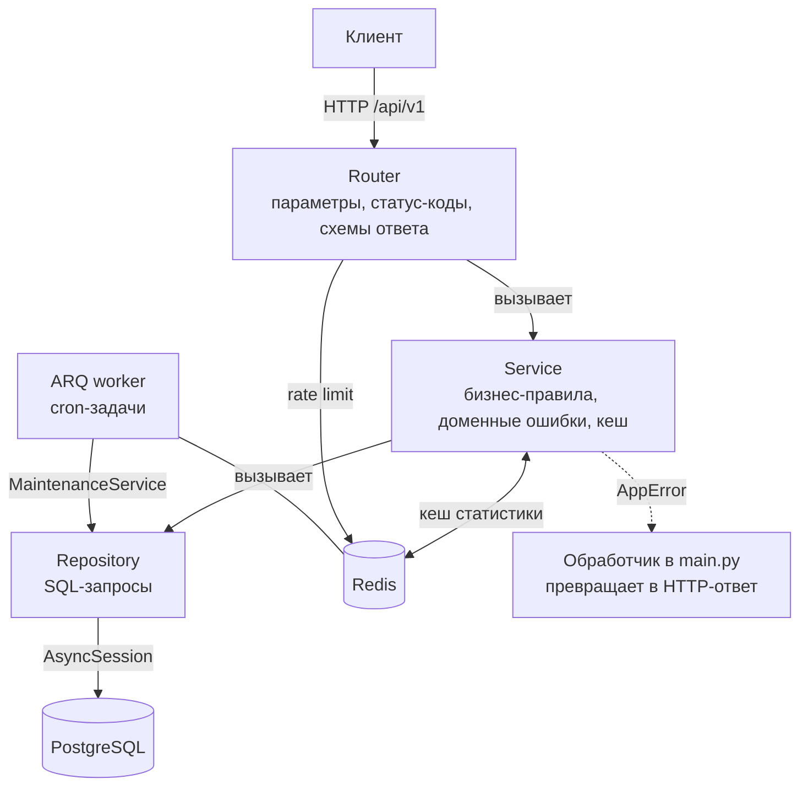
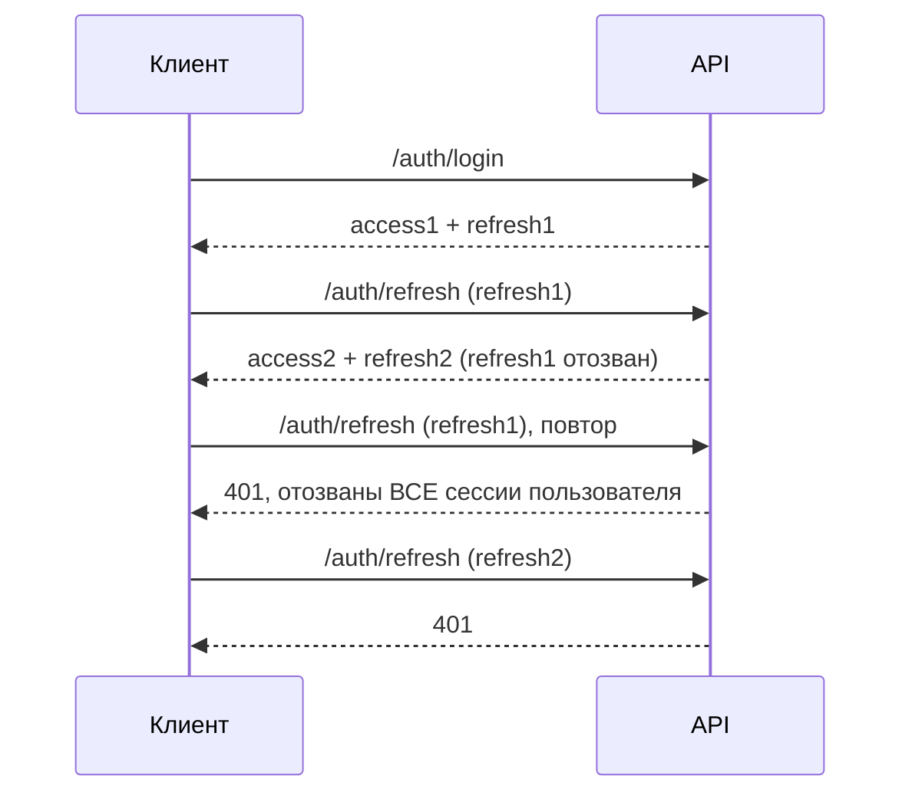

# TaskFlow API

[](https://github.com/arlanbekbergen3-alt/taskflow-api/actions/workflows/ci.yml)

Асинхронный REST API личного таск-трекера на FastAPI, PostgreSQL и Redis. Задачи с приоритетами, дедлайнами и тегами, корзина, персональные категории, поиск и фильтры, кешируемая статистика, фоновые напоминания. Авторизация по JWT с ротацией refresh-токенов. Каждый пользователь видит только свои данные.

## Что умеет

- **Задачи:** название, описание, приоритет (`low|medium|high`), дедлайн с часовым поясом, теги, категория. Сервер сам ведёт `created_at`, `updated_at`, `completed_at` и признак `is_overdue`.
- **Корзина:** `DELETE` не стирает задачу, а переносит в корзину. Её можно посмотреть (`GET /tasks/trash`) и вернуть (`POST /tasks/{id}/restore`). Через 30 дней фоновая задача удаляет её окончательно.
- **Выборка:** фильтры (`completed`, `priority`, `category_id`, `tag`, `overdue`, `due_before`, `due_after`), поиск `q` по названию и описанию, сортировка, пагинация. Порядок всегда детерминирован.
- **Статистика:** `GET /tasks/stats` (всего, выполнено, просрочено, доля выполнения, разбивка по приоритетам) с кешем в Redis.
- **Авторизация:** регистрация, логин (OAuth2 password flow, в Swagger работает кнопка Authorize), refresh с ротацией, logout, rate limit на вход.
- **Фоновые задачи:** напоминания о приближающихся дедлайнах и уборка устаревших данных (ARQ-воркер).
- **Эксплуатация:** версионирование API (`/api/v1`), CORS по списку, `/health` с проверкой БД и Redis, `X-Request-ID` в ответах и логах, JSON-логи, непривилегированный пользователь в контейнере.

Redis необязателен: без `REDIS_URL` API работает, просто без кеша и с rate limit в памяти процесса.

## Быстрый запуск (Docker)

Нужен Docker с Compose.

```bash
cp .env.example .env
# в .env достаточно задать DB_PASSWORD и JWT_SECRET_KEY, например:
#   python -c "import secrets; print(secrets.token_urlsafe(48))"
docker compose up --build
```

Поднимаются четыре сервиса: `postgres`, `redis`, `web` (применяет миграции и запускает API) и `worker` (фоновые задачи; стартует, когда API стал healthy).

- Swagger: http://localhost:8000/docs
- Проверка: `curl http://localhost:8000/health` → `{"status":"ok","redis":"up"}`
- PostgreSQL снаружи на порту `5433`, Redis на `6380`

Пример сценария:

```bash
curl -X POST localhost:8000/api/v1/auth/register -H 'Content-Type: application/json' \
     -d '{"username":"demo","password":"password123"}'

curl -X POST localhost:8000/api/v1/auth/login -d 'username=demo&password=password123'
# → {"access_token": "...", "refresh_token": "...", "token_type": "bearer"}

curl -X POST localhost:8000/api/v1/tasks -H "Authorization: Bearer <access_token>" \
     -H 'Content-Type: application/json' \
     -d '{"title":"Write README","priority":"high","tags":["docs"]}'

curl -i localhost:8000/api/v1/tasks/stats -H "Authorization: Bearer <access_token>"
# первый ответ X-Cache: MISS, повторный X-Cache: HIT
```

## Локальная разработка

```bash
python -m venv .venv && source .venv/bin/activate   # Windows: .venv\Scripts\activate
pip install -r requirements-dev.txt
docker compose up -d postgres redis                 # только инфраструктура
```

В `.env` укажите `DATABASE_URL=postgresql+asyncpg://postgres:<DB_PASSWORD>@localhost:5433/taskflow_db` и, по желанию, `REDIS_URL=redis://localhost:6380/0`. Затем:

```bash
alembic upgrade head
uvicorn main:app --reload
arq worker.WorkerSettings        # в отдельном терминале; нужен REDIS_URL
```

## Архитектура

Трёхслойная: каждый слой знает только о соседнем снизу.



| Слой | Ответственность |
|---|---|
| `routers/` | HTTP: разбор параметров, валидация (Pydantic), коды ответов. Сервисы получают через `Depends`. |
| `services/` | Правила: проверка владельца категории, `completed_at`, корзина, кеш. Бросают `NotFoundError`, `ConflictError`, `UnauthorizedError`, `RateLimitError`, а не `HTTPException`. |
| `repositories/` | Только работа с БД через SQLAlchemy 2.0 (async). Фильтры, сортировка, агрегаты. |
| `models/`, `schemas/` | ORM-модели и Pydantic-схемы запросов и ответов. |
| `core/` | Конфиг, безопасность, rate limit, кеш, Redis, логирование, CORS, зависимости. |
| `worker.py` | Точка входа ARQ: расписание, сама логика в `services/maintenance.py`. |

Изоляция данных: каждый запрос к задачам, категориям и тегам фильтруется по `user_id` текущего пользователя. Чужой объект выглядит как несуществующий (404), а не запрещённый (403), чтобы не раскрывать факт его существования.

## Авторизация и ротация refresh-токенов

- `POST /auth/login` отдаёт пару: короткоживущий **access-токен** (JWT, 30 минут) и **refresh-токен** (случайная строка, 7 дней).
- В базе хранится только SHA-256 refresh-токена: утечка БД не даёт готовых сессий.
- `POST /auth/refresh` меняет refresh-токен на новую пару, а старый **сразу отзывается**. Каждый refresh-токен годится ровно один раз.



**Почему повторное использование считается кражей.** Честный клиент всегда хранит самый свежий токен и не предъявляет старый. Если отозванный токен пришёл снова, значит, у него есть копия: либо она у злоумышленника, либо он уже потратил украденный токен, а настоящий клиент пришёл со старым. Определить, кто из двоих легитимен, сервер не может, поэтому отзывает все refresh-токены пользователя и требует войти заново. Параллельные запросы с одним токеном тоже безопасны: отзыв выполняется атомарным `UPDATE ... WHERE revoked_at IS NULL`, успешным будет только один.

`POST /auth/logout` отзывает токен (идемпотентно).

## Redis

**Rate limit** на `/auth/login` и `/auth/refresh`: по умолчанию 10 запросов в минуту с одного IP, дальше 429 и `Retry-After`. Счётчик в Redis (`INCR` + `EXPIRE`) общий для всех реплик API. Это окно фиксированной длины, поэтому на стыке окон клиент может сделать до двойного лимита; для защиты входа это приемлемо. Если Redis не настроен или недоступен, включается лимитер в памяти процесса (в логе предупреждение). За reverse proxy запускайте uvicorn с `--proxy-headers`, иначе все клиенты будут для лимитера одним IP.

**Кеш `GET /tasks/stats`.** Ключ `stats:<user_id>`, время жизни 60 секунд. Ответ содержит заголовок `X-Cache`: `HIT`, `MISS` или `BYPASS` (кеш выключен). Любое изменение задач пользователя (создание, правка, удаление, восстановление) сбрасывает его ключ. Кеш не может сломать запрос: при ошибках Redis чтение считается промахом, запись и сброс игнорируются. Окно устаревания ограничено TTL: просроченность зависит от текущего времени, поэтому значение живёт недолго.

## Фоновые задачи

Воркер на [ARQ](https://arq-docs.helpmanual.io/) (`arq worker.WorkerSettings`), логика в `services/maintenance.py`, расписание в `worker.py`.

| Задача | Расписание | Что делает |
|---|---|---|
| `reminders_job` | каждые 15 минут | находит открытые задачи с дедлайном в ближайшие 24 часа и отправляет напоминание один раз |
| `purge_job` | ежедневно в 03:00 UTC и при старте | удаляет просроченные refresh-токены и задачи, пролежавшие в корзине больше 30 дней |

- **Напоминание отправляется один раз.** Задача помечается (`reminder_sent_at`) тем же `UPDATE ... RETURNING`, которым выбирается, поэтому два воркера не возьмут одну задачу. Цена: если процесс упадёт между пометкой и отправкой, напоминание потеряется, а не продублируется. Перенос дедлайна снова «взводит» напоминание.
- **Доставка подключаема.** Сейчас `LogNotifier` пишет в лог; e-mail или push добавляются реализацией протокола `Notifier`, без изменений в задаче.
- **Отозванные, но не истёкшие refresh-токены не удаляются.** Именно по ним сервер узнаёт повторно предъявленный (украденный) токен.

## Тесты

Нужен PostgreSQL по `DATABASE_URL`; тесты сами создают и удаляют отдельную БД `taskflow_test`. Redis в тестах подменяется `fakeredis`, поэтому сервер не нужен; один тест, который идёт против настоящего Redis, запускается при заданной `REDIS_TEST_URL` (в CI она задана).

```bash
pytest                                  # 80 тестов (79 + 1 для настоящего Redis)
pytest --cov --cov-report=term-missing  # с покрытием
ruff check . && ruff format --check .   # линтер и форматирование
mypy                                    # проверка типов
alembic upgrade head && alembic check   # модели совпадают с миграциями
```

Результат последнего прогона: **80 тестов проходят, покрытие 95,65%** (943 строки, 41 не покрыта; CI требует не менее 90%). Тесты интеграционные: реальная БД, реальные HTTP-вызовы через `httpx`. Покрыты изоляция пользователей, валидация, фильтры, статистика и её кеш (HIT/MISS, сброс, деградация при сбое Redis), общий rate limit и fallback, корзина, напоминания (однократность, повторный взвод, сбой доставки), очистка (включая сохранность отозванных токенов), ротация и кража refresh-токена, CORS, версионирование. `worker.py` не входит в отчёт о покрытии; его запуск проверен вручную в Docker.

CI (`.github/workflows/ci.yml`) на каждый push в `main` и pull request: ruff check, ruff format --check, mypy, PostgreSQL и Redis как сервисы, `alembic upgrade head`, `alembic check`, pytest с покрытием. Версии actions закреплены по SHA.

## Миграции

```bash
alembic upgrade head                           # накатить всё
alembic downgrade -1                           # откатить последнюю
alembic downgrade base                         # откатить всё
alembic revision --autogenerate -m "описание"  # новая миграция по изменениям моделей
alembic check                                  # есть ли расхождение моделей и схемы
```

Миграции проверены в обе стороны, включая перенос данных: существующие дубли имён категорий получают суффикс `(2)`, `(3)`, а у старых задач появляются значения по умолчанию.

## Стек

Python 3.11 · FastAPI · SQLAlchemy 2.0 (async) + asyncpg · PostgreSQL 15 · Redis 7 · ARQ · Alembic · Pydantic v2 · PyJWT + bcrypt · pytest, pytest-asyncio, fakeredis, httpx · ruff, mypy · Docker Compose · GitHub Actions

## Структура

```
.
├── main.py                 # приложение, /api/v1, обработчик ошибок, middleware, /health
├── worker.py               # ARQ: расписание фоновых задач
├── core/                   # config, security, auth, dependencies, rate_limit, cache, redis, cors, logging, exceptions
├── routers/                # auth, tasks, categories
├── services/               # user, task, category, maintenance (фоновые задачи), notifier
├── repositories/           # user, task, category, tag, refresh_token
├── models/                 # ORM: user, task, category, tag, refresh_token
├── schemas/                # Pydantic-схемы
├── db/                     # Base, engine и сессии
├── alembic/versions/       # миграции
├── tests/                  # интеграционные тесты
├── conftest.py             # тестовая БД, клиент, фабрика пользователей, fakeredis
├── Dockerfile
├── docker-compose.yml      # postgres, redis, web, worker
├── pyproject.toml          # ruff, mypy, pytest, coverage
├── requirements.txt        # зависимости приложения
├── requirements-dev.txt    # + тесты и линтеры
└── .env.example            # шаблон конфигурации без секретов
```

## Конфигурация

Переменные окружения или `.env` (см. `.env.example`). Без `DATABASE_URL` и `JWT_SECRET_KEY` приложение не запускается. В `docker compose` достаточно `DB_PASSWORD` и `JWT_SECRET_KEY`, остальное он задаёт сам.

| Переменная | По умолчанию | Назначение |
|---|---|---|
| `DATABASE_URL` | — | строка подключения (`postgresql+asyncpg://...`) |
| `JWT_SECRET_KEY` | — | ключ подписи JWT |
| `REDIS_URL` | не задан | включает кеш и общий rate limit; нужен воркеру |
| `ACCESS_TOKEN_EXPIRE_MINUTES` | `30` | срок жизни access-токена |
| `REFRESH_TOKEN_EXPIRE_DAYS` | `7` | срок жизни refresh-токена |
| `LOGIN_RATE_LIMIT_ATTEMPTS` / `LOGIN_RATE_LIMIT_WINDOW_SECONDS` | `10` / `60` | лимит входа по IP |
| `STATS_CACHE_TTL_SECONDS` | `60` | время жизни кеша статистики |
| `CORS_ORIGINS` | `[]` | разрешённые источники, JSON-список; пусто — CORS выключен |
| `REMINDER_WINDOW_HOURS` | `24` | за сколько часов до дедлайна напоминать |
| `TRASH_RETENTION_DAYS` | `30` | сколько хранить задачи в корзине |
| `LOG_LEVEL`, `LOG_FORMAT` | `INFO`, `text` | уровень и формат (`text` или `json`) логов |
| `DB_PASSWORD` | — | пароль БД для `docker compose` |
